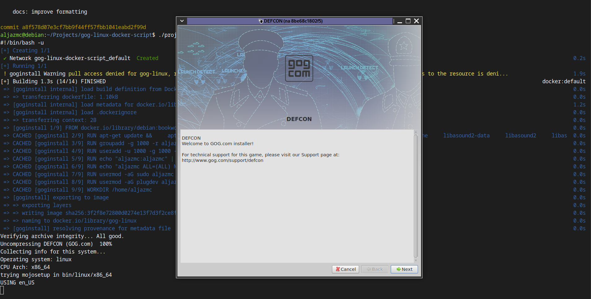

[](LICENSE)

# gog-linux-docker-script

A single bash script for installing and running GOG games (Linux versions) inside a Docker container, so nothing gets installed on your host system.

## > Features

* **run GOG games in isolated containers** – the game and its dependencies stay in the project folder
* **automatic installation** – finds the GOG installer(s) in the folder and runs them, including DLCs
* **graphics and sound** – passes through X11, GPU (`/dev/dri`) and audio (`/dev/snd`) to the container
* **easy cleanup** – one command removes the container, the image and everything the game installed

## > Prerequisites

* GNU/Linux system with bash shell
* Docker with the [compose plugin](https://docs.docker.com/compose/install/linux/), running and usable by your user (no `sudo`)
* X11 session (or XWayland) with `DISPLAY` set
* a Linux GOG game installer (`.sh` file, e.g. `gog_defcon_2.0.0.5.sh`), plus any DLC installers

The container uses the [`aljazmc/x11-debian`](https://hub.docker.com/r/aljazmc/x11-debian) image, which is pulled automatically on first run.

## > Getting Started

```bash
## > clone the project into a folder named after the game
git clone https://github.com/aljazmc/gog-linux-docker-script defcon

## > move the GOG game installer (for Linux OS) and all DLC installers into the folder
mv ~/Downloads/gog_defcon_2.0.0.5.sh defcon/

## > move to the game folder
cd defcon

## > install (on first run) and start the game
./project.sh start

## > remove everything generated by project.sh
./project.sh clean
```

During the first `start`, the GOG installer window opens. Keep the default install location, so the game ends up in the `GOG Games` folder inside the project folder.

> [!CAUTION]
> Put only one game (with its DLCs and extras) in each project folder. For more games, clone the project once per game.

## > Commands

| Command              | What it does |
| -------------------- | ------------ |
| `./project.sh start` | Generates `docker-compose.yml`. If `GOG Games` doesn't exist yet, it makes all `.sh` files executable and runs every installer in the folder. Then it finds the game's `start.sh` and launches the game. |
| `./project.sh clean` | Stops the container, removes its volumes and image (`docker compose down -v --rmi all`) and deletes all generated files and folders, including the installed game. Your installer `.sh` files are kept, so you can reinstall with `./project.sh start`. |

On subsequent runs, `./project.sh start` skips installation and launches the game directly. Running `./project.sh` without a command prints the usage.

## > Troubleshooting

* **`Compose plugin is not installed. Exiting...`** – install the Docker compose plugin.
* **`No .sh file found. Exiting...`** – the GOG installer is missing from the project folder.
* **game window doesn't open** – make sure `DISPLAY` is set and `~/.Xauthority` exists; on some systems you may need to run `xhost +local:` first.
* **reinstall the game** – delete the `GOG Games` folder (or run `./project.sh clean`) and run `./project.sh start` again.

## > Screenshot

Install screen for DEFCON:

