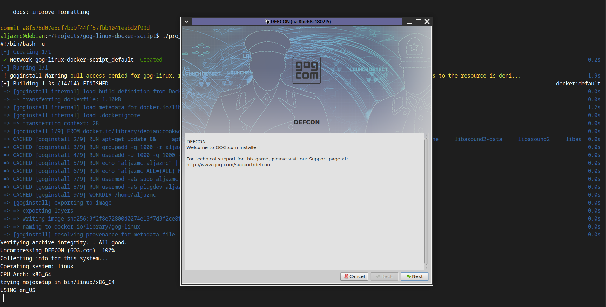

# gog-linux-docker-script

[](https://github.com/aljazmc/gog-linux-docker-script/actions/workflows/lint.yml)
[](LICENSE)
[](https://docs.docker.com/compose/)
[](https://www.gog.com/)
[](https://hub.docker.com/r/aljazmc/x11-debian)
[](https://www.gnu.org/software/bash/)
[](https://www.shellcheck.net/)
[](https://www.conventionalcommits.org/)

GOG games for Linux, installed and played inside a Docker container. A
single bash script runs the game's installer and its DLCs in a container,
then starts the game with your display, GPU and sound, so nothing gets
installed on your host system.



## Features

- **Isolated games.** The game and its dependencies stay in the project
  folder, not on the host.
- **Automatic installation.** It finds the GOG installer in the folder and
  runs it, with every DLC and extra installer next to it.
- **Graphics and sound.** X11, the GPU (`/dev/dri`) and audio (`/dev/snd`)
  are passed through to the container, with the runtime directory where the
  PipeWire or PulseAudio socket lives.
- **Easy cleanup.** One command removes the container, the image and
  everything the game installed, and keeps your installers.

## Quick start

```sh
# clone the project into a folder named after the game
git clone https://github.com/aljazmc/gog-linux-docker-script defcon

# move the GOG game installer (for Linux) and all DLC installers into the folder
mv ~/Downloads/gog_defcon_2.0.0.5.sh defcon/

# move to the game folder
cd defcon

# install (on first run) and start the game
./project.sh start

# remove everything generated by project.sh
./project.sh clean
```

During the first `start`, the GOG installer window opens. Keep the default
install location, so the game ends up in the `GOG Games` folder inside the
project folder.

> [!CAUTION]
> Put only one game (with its DLCs and extras) in each project folder. For
> more games, clone the project once per game.

## Requirements

| Requirement | Notes |
| --- | --- |
| GNU/Linux with bash | |
| Docker | with the [compose plugin](https://docs.docker.com/compose/install/linux/), running and usable by your user (no `sudo`) |
| X11 session | or XWayland, with `DISPLAY` set |
| A Linux GOG installer | a `.sh` file, e.g. `gog_defcon_2.0.0.5.sh`, plus any DLC installers |

The container uses the [`aljazmc/x11-debian`](https://hub.docker.com/r/aljazmc/x11-debian)
image, which is pulled automatically on first run.

## Commands

| Command | What it does |
| --- | --- |
| `./project.sh start` | Generates `docker-compose.yml`. If `GOG Games` doesn't exist yet, it makes all `.sh` files executable and runs every installer in the folder. Then it finds the game's `start.sh` and launches the game. |
| `./project.sh clean` | Stops the container, removes its volumes and image (`docker compose down -v --rmi all`) and deletes all generated files and folders, including the installed game. Your installer `.sh` files are kept, so you can reinstall with `./project.sh start`. |

On subsequent runs, `./project.sh start` skips installation and launches the
game directly. Running `./project.sh` without a command prints the usage.

## Troubleshooting

- **`Compose plugin is not installed. Exiting...`**: install the Docker
  compose plugin.
- **`No .sh file found. Exiting...`**: the GOG installer is missing from the
  project folder.
- **The game window doesn't open**: make sure `DISPLAY` is set and
  `~/.Xauthority` exists; on some systems you may need to run
  `xhost +local:` first.
- **Reinstall the game**: delete the `GOG Games` folder (or run
  `./project.sh clean`) and run `./project.sh start` again.

## Tests

```sh
bash tests/test_project.sh
shellcheck project.sh tests/*.sh
```

`tests/test_project.sh` checks that `project.sh` answers an unknown command
with its usage, and that `start` refuses to run without a GOG installer next
to it, before it writes `docker-compose.yml` or runs a container. It runs on
a copy of `project.sh` in a temporary folder, with `docker` replaced by a
stand-in that records its calls. The
[lint](.github/workflows/lint.yml) workflow runs ShellCheck on every push and
pull request.

## License

The script is licensed under the [MIT License](LICENSE). The games you
install with it keep their own licenses.
